# Usage Guide

## Prerequisites

* Windows >= 10 / macOS >= Monterey / Linux (not officially tested — build from source)
* dLive Firmware: 1.9x / 2.x
* dLive Director: 1.9x / 2.x (Optional)
* Avantis Firmware: 1.3x
* Mixing Station (Android / iOS / Desktop) with REST API enabled, port 8080 (Optional)
* Microsoft Excel (ideally Office 365) or LibreOffice Calc Spreadsheet (>25.x.x)
* Reaper >= v6.x (Optional)
* Tracks Live v1.3 (Optional)
* Python 3.12 (Optional, if you want to build the software yourself)

## Running the Tool

To run the tool, you have two options:

**A: Use a pre-built release**

Download the latest release (see [README download table](../README.md#download)), unzip it, and start the `dmt` executable. If the tool does not start automatically, try "Open with → Terminal" or run it from the terminal.

If you see the following message:

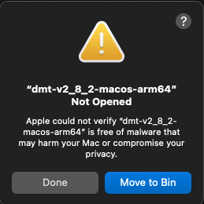

Go to System Preferences → Privacy and Security → Security → Open Anyway

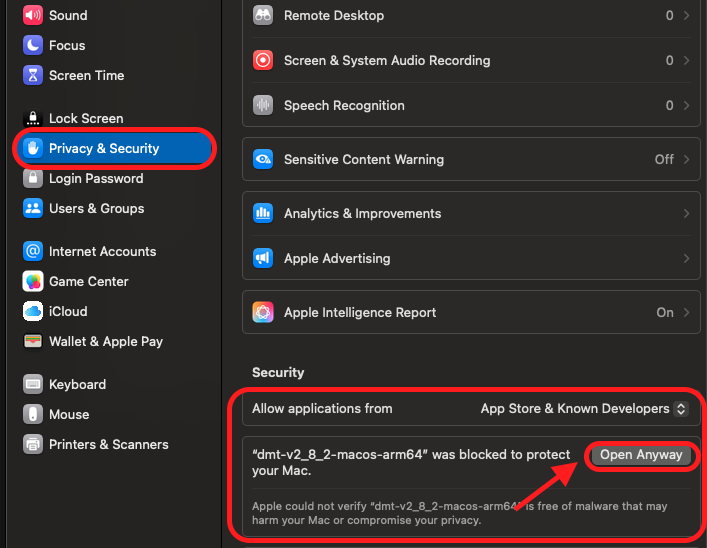

Enter your password and click:

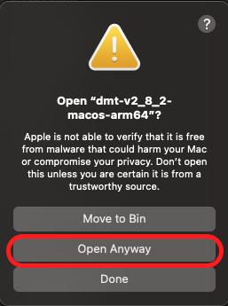

Continue with [Step 4](#step-4--launch).

**B: Build from source**

B1. Install required Python modules:

```
pip install -r requirements.txt
```

B2. Run the script:

```
cd src
python3 Main.py
```

B3. *(Optional)* Create a binary:

B3.1 Install PyInstaller:

```
pip install pyinstaller
```

B3.2 Create a one-file binary (works for Windows and macOS):

```
pyinstaller -y --onefile -w ./src/Main.py
```

## Step 4 — Launch

The following window appears after launch. This can take a couple of seconds.

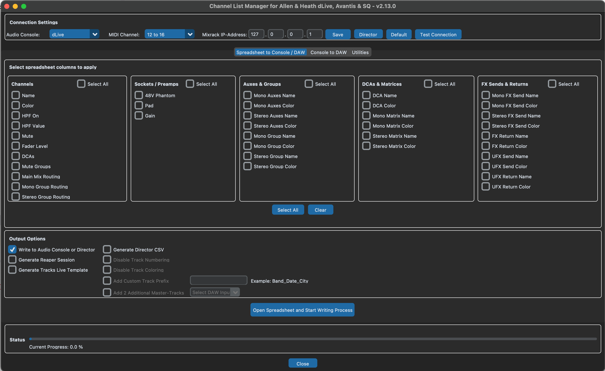

> **Recommendation:** Please back up your current show file before proceeding.

> **_Recommended Workflow:_** If socket patching is to be performed, first export to CSV and import into Director. This establishes the channel naming baseline for further MIDI-based data processing.

## Menu Bar

The menu bar at the top of the window provides the following options:

**Settings**
- `Dark Mode` — toggles between dark and light appearance. The selected mode is persisted across restarts.
- `Mixer Config...` — opens the mixer config dialog, see [Mixer Config](#mixer-config). Disabled when Mixing Station is selected.

**Help**
- `Documentation` — opens the online documentation in your browser
- `Check for Updates` — fetches the latest release info and shows whether a newer version is available, with a direct download link if so
- `Support Project ☕` — opens the donation page
- `About` — shows version information
- `Close` — exits the application

The same `☕ Support Project` action is also available as a button at the bottom of the main window, next to `Close`.

## Console Selection & Connection Settings

1. Select the console: `dLive`, `Avantis`, or `Mixing Station`

2. Check the IP address. For dLive / Avantis also check the MIDI Port. For Mixing Station, select the console type (SQ, DM7, Wing, M32/X32, QU), then enter the host IP and port (default: 8080). See [How-To: Mixing Station Integration](howto-mixing-station.md) for a step-by-step guide.

3. `Save` — persists the current settings (console, IP, MIDI port) for the next start of the tool.

4. `Director` — sets the IP to 127.0.0.1 to use Director locally on the same machine. Director must be started first. You can also write to a Director instance on a different machine by entering its IP address. (If you have connection issues, check the firewall rules or disable it temporarily.)

5. `Default` — sets the IP back to the default: 192.168.1.70.

6. `Test Connection` — tries to establish a test connection to the console. You will be informed by a pop-up in both cases (successful / failed).

## Console Settings (Mixing Station)

For a full step-by-step guide on setting up and using Mixing Station with dmt, see:

**→ [How-To: Mixing Station Integration](howto-mixing-station.md)**

## Console Settings (dLive / Avantis)

The `MIDI Channel` setting on dLive under `Utils/Shows → Control → MIDI` should be set to `12 to 16`, which is the default.

If you want to change the preconfigured MIDI port, you can change it in the GUI according to your dLive settings.

## Mixer Config

The mixer config tells the tool how many buses are configured on your console (Mixrack / Avantis mixer configuration). The tool uses these amounts as boundaries and does not write beyond them, so no data is sent to buses which do not exist in the current configuration.

Open it via `Settings → Mixer Config...` or by clicking the mixer config summary next to `Open Spreadsheet and Start Writing Process`.

| Field | Meaning |
|-------|---------|
| Group / FX / Aux / Matrix — Mono | Amount of mono buses of this type |
| Group / FX / Aux / Matrix — Stereo | Amount of stereo buses of this type |

* Enter the amounts exactly as configured on the console. All 8 fields are required — enter `0` for bus types which are not used. As long as a field is empty, `Save as Preset...` / `OK` are disabled.
* Mono buses are configured in pairs on the console, so only **even** mono amounts are allowed (0, 2, 4, …). Stereo amounts can be odd.
* The highest value per field is shown next to it:

  | Console | Group / Aux / Matrix | FX |
  |---------|----------------------|----|
  | dLive | 60 / 30 | 16 / 16 |
  | Avantis | 38 / 19 | 12 / 12 |

* **Bus count check:** the dialog adds up all entered buses (a stereo bus counts twice) and compares the sum with the buses available on the console. 4 buses are always in use for Main LR (2) and PAFL (2) and are already subtracted:

  | Console | Bus pool | Available for Group / FX / Aux / Matrix |
  |---------|----------|-----------------------------------------|
  | dLive | 64 | 60 |
  | Avantis | 42 | 38 |

  If more buses are entered than available, a mono amount is odd, or a field contains an invalid value, the affected fields turn red, the reason is shown below the bus count, and `Save as Preset...` / `OK` are disabled until the values are corrected.

| Button | Behaviour |
|--------|-----------|
| `Reset` | Clears all fields |
| `OK` | Saves the entered mixer config as the active mixer config of the selected console and uses it from now on |
| `Cancel` | Closes the dialog without changes |

**Presets** — mixer configs can be stored under a name, e.g. one per show or venue. Presets are stored per console (dLive and Avantis have separate presets).

| Control | Behaviour |
|---------|-----------|
| `Preset` | Select a preset to fill the fields with its values. The values become active with `OK`. |
| `Save as Preset...` | Asks for a name (1–40 characters) and stores the entered values as preset. An existing preset with the same name is overwritten after confirmation. |
| `Delete Preset` | Deletes the selected preset after confirmation |

On start and when switching the console, the active mixer config of the selected console is loaded automatically. If it matches a preset, the preset is preselected when opening the dialog. The active mixer config is shown next to `Open Spreadsheet and Start Writing Process`, e.g. `Mixer Config: Group 8/4, FX 8/4, Aux 12/6, Matrix 4/0`. Without a mixer config, `Mixer Config: not set (no limits)` is shown — then all rows of the spreadsheet are written and the Utilities use their default amounts.

The active mixer config and the presets are stored in `config.json` together with the other settings. The file is located in the directory the tool is started from.

The mixer config is applied to:

| Feature | Boundary |
|---------|----------|
| `Channels` tab — Mono / Stereo Group Assignment | Only groups within the configured amount are assigned (dLive only) |
| `Groups` tab — Aux, Group, Matrix, FX Send names and colors | Rows beyond the configured amount are skipped (see log) |
| Utilities — `MUTE all Outputs` / `UNMUTE all Outputs` | Exactly the configured Aux, Group, Matrix and FX Send buses are switched |

DCA, FX Returns and UFX Sends / Returns are not part of the mixer config and are not limited.

> **_NOTE:_** The `Mixer Config` tab in the spreadsheet is only a report of the buses used in the spreadsheet. The boundaries are taken from the mixer config in the tool.

> **_NOTE:_** The mixer config is not available for Mixing Station.

## Default IP Address

The default dLive Mixrack IP address is `192.168.1.70`, preconfigured in the tool. You can change it in the `ip` field in `dliveConstants.py` or at runtime in the GUI.

Make sure your network interface has an IP address in the same subnet, e.g. IP: `192.168.1.10` / Subnet: `255.255.255.0`

## Operating Modes

The tool has the following modes — choose which one you want to use:

* **Spreadsheet to Console / DAW** — reads from a spreadsheet and writes to a console or DAW session.
* **Console to DAW** — reads from the console and writes a DAW session.
* **Utilities** — direct console operations without a spreadsheet.
* **Export** — writes the channel list to a Dante Config Editor compatible JSON or CSV file, or exports/prints it as a PDF.

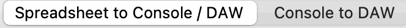

## Spreadsheet to Console / DAW

7. Select the spreadsheet columns you want to write and then select `Write to Audio Console or Director`.

   `Select All` and `Clear` select or deselect all checkboxes.

8. If you also want to create a DAW session template (Reaper or Tracks Live), set the corresponding tick. The session files `<input-spreadsheet-file>-reaper-recording-template.rpp` / `<input-spreadsheet-file>-trackslive-recording.template` will be generated into the same directory as the spreadsheet. In the `Channels` tab you can configure which channels shall be recorded and record-armed. Patching is 1:1 (derived from the channel number).

   The following DAW-based options are available:
   * Disable Track Numbering
   * Disable Track Coloring
   * An additional custom track prefix can be added.
   * Add two additional mono busses to record your mix sum.

> **_NOTE:_** You can also use the tool to create only the DAW session file (Reaper or Tracks Live) without a console connection. In this case, disable "Write to Audio Console or Director", choose your DAW, and continue with Step 11.

9. `Generate Director CSV (Columns: Name, Color, Source, Socket, Gain, Pad, Phantom)` — generates a CSV file for Director including Name, Color, Patching, Gain, Pad, Phantom. This can be used as a baseline for MIDI-based parameters.

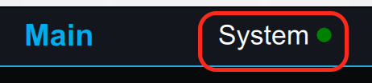

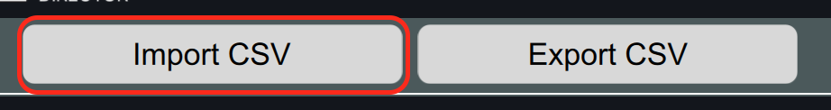

> **_NOTE:_** This feature uses the columns Name, Color, Source, Socket, Gain, Pad, Phantom from the `Channels` tab.

10. Click `Open Spreadsheet and Start Writing Process` to select the spreadsheet. The selected action(s) start automatically.

   If no mixer config has been saved for the selected console yet, the [Mixer Config](#mixer-config) dialog opens first when writing to the console. Enter the amount of buses configured on the console and confirm with `OK` — the mixer config is saved and used from now on. `Cancel` aborts the writing process.

   Before processing, the tool automatically validates the spreadsheet. The validator checks:
   - Channel and group **names** for invalid characters
   - **Colors** against the supported color list
   - **Fader levels** against the supported value list
   - **HPF values** for valid range
   - **Channel numbers** against the console's maximum (128 for dLive, 64 for Avantis)
   - **Source field** values per console type (dLive / Avantis)
   - **Mute**, **HPF On**, **DCA**, **Mute Group**, **Group Routing** toggle values
   - **Phantom**, **Pad**, and **Gain** values in the Sockets tab

   If any validation errors are found, a summary is shown and processing is aborted.

   **Recommendation:** Test it first with the delivered spreadsheet to make sure everything works properly.

## Console to DAW

11. Generates a DAW session from the current console or Mixing Station settings. This can be triggered at any time when an existing show is loaded. No spreadsheet is required.

The generated files `current-console-reaper-recording-template.rpp` (Reaper) / `current-console-trackslive-recording.template` (Tracks Live) are created in the folder you choose.

The source is determined automatically from the console selection in Connection Settings:
* **dLive / Avantis** — channel names and colors are read via MIDI/TCP (SysEx)
* **Mixing Station** — channel names and colors are read via REST API (`GET /console/data/get/ch.N.cfg.name|color/val`); channel range is limited to 1–99

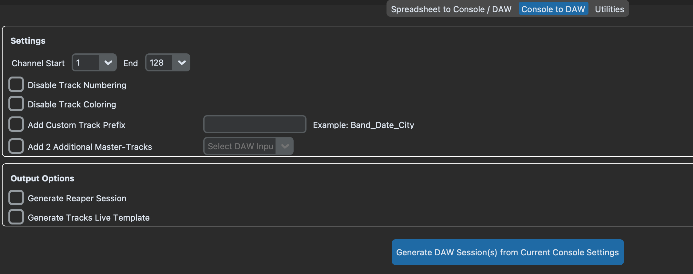

Options:
   * Choose `Start` and `End` channel for DAW generation.
   * Disable Track Numbering
   * Disable Track Coloring
   * An additional custom track prefix can be added.
   * Add two additional mono busses to record your mix sum.

Click `Generate DAW Session(s) from Current Console Settings`.

## Utilities

12. The `Utilities` tab provides direct console operations without requiring a spreadsheet. IP address, MIDI port, and console type from the connection settings apply here as well.

> **_NOTE:_** Utilities are not available when Mixing Station is selected — all buttons are disabled in that case.

### Reset

| Button | Description | Console Support |
|--------|-------------|-----------------|
| RESET all DCA Assignments | Removes all DCA assignments from every channel | dLive & Avantis |
| RESET all Mute Group Assignments | Removes all Mute Group assignments from every channel | dLive only |
| RESET all Main Assignments | Removes all Main Mix assignments from every channel | dLive & Avantis |

### Mute

| Button | Description | Console Support |
|--------|-------------|-----------------|
| MUTE all Inputs | Mutes all input channels | dLive & Avantis |
| MUTE all Outputs | Mutes all output channels (Aux, Groups, Matrices, FX Sends/Returns, UFX Sends/Returns) | dLive & Avantis |
| UNMUTE all Inputs | Unmutes all input channels | dLive & Avantis |
| UNMUTE all Outputs | Unmutes all output channels (Aux, Groups, Matrices, FX Sends/Returns, UFX Sends/Returns) | dLive & Avantis |

> **_NOTE:_** `RESET all Mute Group Assignments` is disabled when Avantis is selected, as Mute Groups are not available on that console.

> **_NOTE:_** `MUTE all Outputs` / `UNMUTE all Outputs` switch exactly the Aux, Group, Matrix and FX Send buses set in the [Mixer Config](#mixer-config). Without a saved mixer config, a conservative default amount per bus type is used.

### Fader

| Button | Description | Console Support |
|--------|-------------|-----------------|
| Set all Input Faders to 0 dB | Sets all input channel faders to unity gain (0 dB) — useful as a soundcheck starting point | dLive & Avantis |
| Set all Input Faders to -inf | Sets all input channel faders to minimum (-inf) — useful for a silent start | dLive & Avantis |

### Preamp Safety

| Button | Description | Console Support |
|--------|-------------|-----------------|
| Phantom Power OFF (all Sockets) | Switches 48V phantom power off on all sockets (Local, DX1, DX3 for dLive; Local, SLink for Avantis) — use before changing microphones | dLive & Avantis |

## Export Tab

13. The **Export** tab's **Settings** box lets you choose the **Channel Start / End** range and pick where the channel names should be read from, before using either export box below.

   | Source | Behaviour |
   |--------|-----------|
   | `Console / Mixing Station` | Reads the current channel list live from the connected console or Mixing Station — no spreadsheet required |
   | `DMT Spreadsheet` | Prompts for a dmt Channel List spreadsheet (`.xlsx`) and reads the channel names from its `Channels` sheet — no console connection required |

### Export to Dante Config Editor

Writes the channel list to a file format compatible with [Dante Config Editor](https://github.com/Mamat79/Dante-Config-Editor) by Mamat79, so channel labels can be imported directly into Dante Config Editor for Dante routing/naming.

   | Button | Behaviour |
   |--------|-----------|
   | `Export Channel List as JSON` | Asks for a save location and writes a `.json` file in the `dante-config-editor-channel-labels` format |
   | `Export Channel List as CSV` | Asks for a save location and writes a `.csv` file with columns `format_version, source_app, source_version, device, direction, channel, dante_id, label` |

   The `device` field in the exported file is taken from the currently selected console / Mixing Station type.

### Export / Print PDF

14. Produces a formatted PDF of the channel list, using the same **Channel Start / End** range and channel-name source as the **Export to Dante Config Editor** box above.

   | Button | Behaviour |
   |--------|-----------|
   | `Export Channel List as PDF` | Asks for a save location and writes a PDF file |
   | `Print Channel List` | Generates a PDF to a temporary file and opens it in the system's default PDF viewer for printing |

   **Columns in the PDF:**

   | Column | Console / Mixing Station | DMT Spreadsheet |
   |--------|---------------------------|------------------|
   | Ch | Yes | Yes |
   | Name | Yes | Yes |
   | Color | Yes — colored cell | Yes — colored cell |

## DAW Recording Sessions

### Reaper

If you select the "Generate Reaper Recording Session" checkbox, the columns `Name`, `Color`, `Recording`, and `Record Arm` are considered for the template generation process.

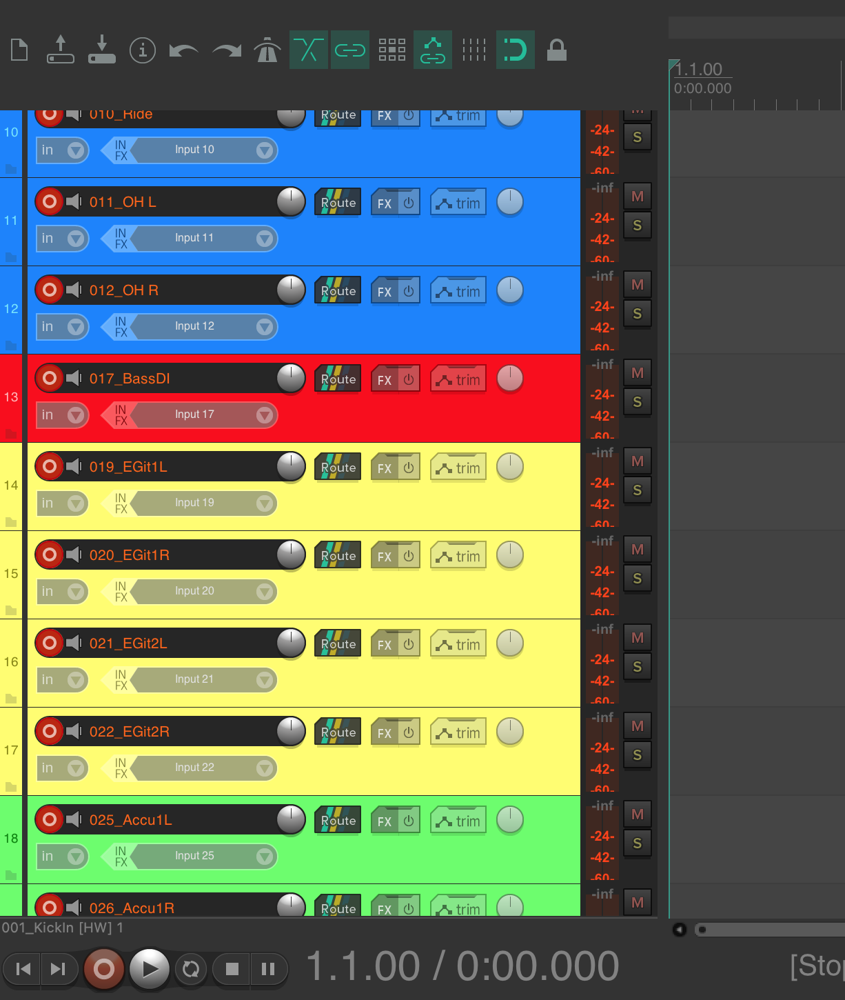

### Tracks Live

If you select the "Generate Tracks Live Template" checkbox, the columns `Name`, `Color`, `Recording`, and `Record Arm` are considered for the template generation process.

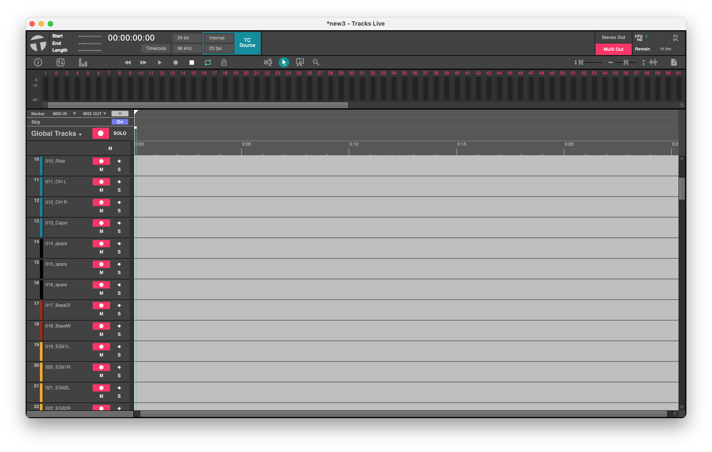

The tool generates a Tracks Live template (`*.template`), which can be used to create a recording session in Tracks Live.

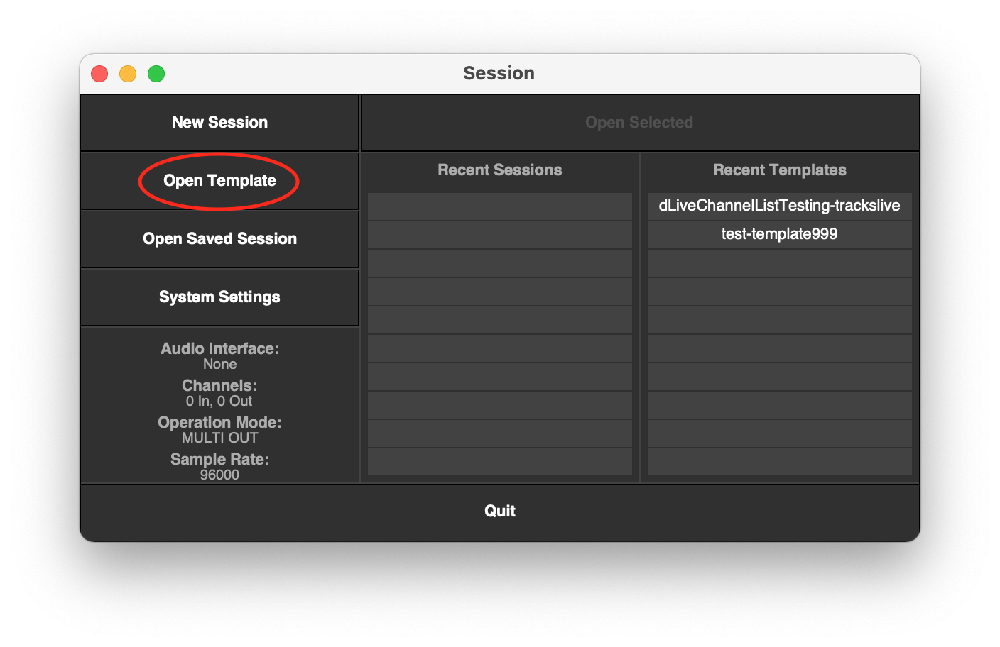

Click on `Open Template` and select the generated file.

## Logs

15. If something goes wrong, please check the Python console or the `main.log`
